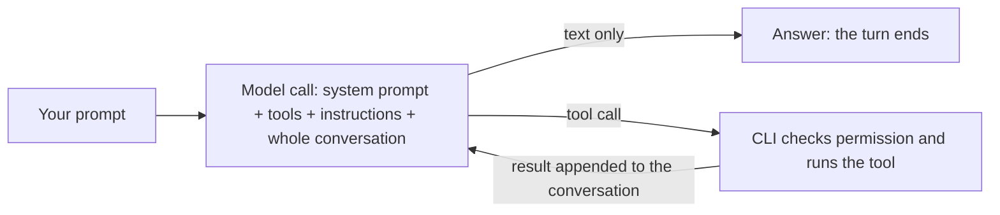

> 🌍 Read this in: **English** | [Česky](00-llm-basics.cs.md)

# 00 · How LLMs and coding agents work

> ⏱ 20 min (12 talk + 8 hands-on) · Docs: [Supported AI models](https://docs.github.com/en/copilot/reference/ai-models/supported-models) · [Choosing a model in Copilot CLI](https://docs.github.com/en/copilot/how-tos/copilot-cli/use-copilot-cli/choose-a-model) · [Managing context](https://docs.github.com/en/copilot/concepts/prompting-and-context/context-management) · Verified on Copilot CLI 1.0.114

## In short

**You need:** Copilot CLI installed and logged in ([01](01-getting-started.md) setup), this repo open. Nothing else.

**What it is for:** A coding agent is a text predictor in a loop that can call tools. Once you know what it sees, what it forgets and what it costs, you know why it gets things wrong and what to change: the prompt, the context or the model.

**Three uses that pay off most:**

1. Pick the model and effort for the task: a cheap, fast model for mechanical edits, `high` effort for a root cause across files.
2. Keep a long session cheap and sharp: `/context` shows what fills the window, `/new` or `/compact` empties it.
3. Read a wrong answer correctly: missing information needs an instruction or a file, not a bigger model.

**How it works:**



## An LLM in seven lines

| Property | What it means in practice |
|---|---|
| **Tokens.** Text is cut into tokens of about 4 characters. Limits and prices count tokens. | `Board.kt` (187 lines, 5.7 kB) is roughly 1,400 tokens each time the model reads it. |
| **Next-token prediction.** The model scores every possible next token, picks one, appends it, repeats. | It continues text. It looks nothing up and runs nothing; that takes tools (next section). |
| **Context window.** All the model sees on one call: system prompt, tool definitions, instructions, conversation, tool results. | What is not in the window does not exist: a file it has not read, a convention nobody wrote down. |
| **Stateless.** Nothing is kept between calls. Every call resends the conversation. Nothing is learned between sessions. | A new session knows nothing from yesterday. What must hold every time lives in files loaded at start. |
| **Training cutoff.** The weights are frozen at a date. | It knows the libraries of that date. This repo's instructions say "This is Spring Boot **4**, not 3" for that reason. |
| **Sampled output.** The next token is drawn from the probabilities. | The same prompt can give a different result. One good run proves nothing. |
| **Fluent, not checked.** A wrong answer reads as well as a right one. | Judge by execution (compile, test, diff), never by how sure the text sounds. |

## From model to agent

A model returns text. An agent is that model in a loop with tools. The model never runs anything:
it emits a structured request, the CLI runs it and appends the result to the conversation.

```
 prompt ─► model call = system prompt + tool definitions + instructions + conversation so far
              ▼
           model answers ─► text only: the turn ends
              │
              └─► tool call (name + JSON arguments)
                     ▼
                  CLI checks permission, runs the tool, appends the result
                     ▼
                  next model call: everything above is sent again
```

Around the model the CLI adds **tools** (read, edit, search, shell, MCP servers; their definitions
are sent on every call), **permissions** (you, a rule, a hook or the sandbox decide before a tool
runs, [08](08-permissions-sandbox.md)), **instructions** (files injected into every request,
[02](02-custom-instructions.md)) and **compaction** (a summary replaces the history when the window fills).

Measured: a one-word prompt in an empty directory sent **20,387 input tokens**; 10,668 of them were
the 31 tool definitions, the rest the system prompt and environment. That overhead is resent on
every call of the loop. Your number differs with your skills, MCP servers and instructions.

## The models you have

As listed on 2026-11-21 ([supported models](https://docs.github.com/en/copilot/reference/ai-models/supported-models), [prices](https://docs.github.com/en/copilot/reference/copilot-billing/models-and-pricing)): models in the CLI on Copilot Business, USD per 1M tokens,
default tier. Several prices are promotional and end. `/model` lists each model's credits per 1M tokens.

| Vendor | Models | Category | Best for (GitHub Docs) | Input / output |
|---|---|---|---|---|
| OpenAI | GPT-6 Luna, GPT-5.6 Luna | Lightweight | Fast help with simple or repetitive tasks | 0.10 / 0.50, 0.20 / 1.20 |
| OpenAI | GPT-6.1 Terra | Versatile | General-purpose coding and agent tasks | 1.00 / 5.00 |
| OpenAI | GPT-5.3-Codex, GPT-6 Sol, GPT-6.1 Sol, GPT-6.2 Sol, GPT-5.6 Sol | Powerful | Agentic and complex coding; 5.6 Sol: deep reasoning and debugging | 1.75 / 14.00 (Codex), 2.00 / 10.00 (Sol), 4.00 / 20.00 (5.6 Sol) |
| OpenAI | GPT-6.2 Astra, GPT-6 Astra | Powerful | Long-horizon, autonomous coding | 8.00 / 40.00, 10.00 / 50.00 |
| Anthropic | Claude Haiku 5.5, Claude Haiku 4.5 | Lightweight, Versatile | Fast help with simple or repetitive tasks | 0.10 / 0.50, 1.00 / 5.00 |
| Anthropic | Claude Sonnet 5, Claude Sonnet 5.5 | Versatile | General-purpose coding and agent tasks | 2.00 / 10.00 |
| Anthropic | Claude Opus 5.5, Claude Opus 4.8 (fast mode) | Powerful | Long-running agentic coding; deep reasoning and debugging | 4.00 / 20.00, 10.00 / 50.00 |
| Anthropic | Claude Fable 5, 5.1, 5.2 | Powerful | Long-horizon, autonomous coding. **Off by default** | 8.00 / 40.00 to 10.00 / 50.00 |
| Google | Gemini 3.8 Flash, Gemini 4 Hydrogen, Gemini 4 Neon | Versatile | Fast simple tasks; agentic coding and multistep workflows | 0.75 / 3.75 to 3.00 / 15.00 |
| Google | Gemini 4 Argon, Gemini 4 Carbon | Powerful | Complex coding and reasoning; Carbon: security-focused work | 2.00 / 10.00 (Carbon 4.00 / 20.00 from 2026-12-01) |
| Microsoft | MAI Code 2 Flash, MAI-Code-1.1-Flash | Lightweight | General-purpose coding and writing | 0.05 / 0.25, 0.20 / 1.20 |
| Microsoft | MAI Code 2 | Powerful | Deep reasoning and complex coding | 0.50 / 2.50 |
| xAI | Grok 4.5, 4.6, 4.7 | Versatile | General-purpose coding and agent tasks | 2.00 / 6.00 |
| Moonshot AI | Kimi K3 | Powerful | Agentic coding and long-context work. **Off by default** | 3.00 / 15.00 |

- **Your organisation decides** which models you can pick. The Claude Fable family (5, 5.1,
  5.2) is off by default: GitHub keeps Fable disabled until an organisation owner enables each model under
  Settings → Copilot → Models ([docs](https://docs.github.com/en/copilot/how-tos/administer-copilot/manage-for-organization/manage-default-models)),
  because it is not covered by GitHub's data retention agreement (Anthropic retains prompts and
  outputs by default to run safety classifiers). Auto never routes to it.
- **Pick one:** `/model` for this session, `copilot --model <model-id>` for one run, `/config model`
  for your default. The picker also lists models you cannot use and says why; by flag one fails
  with `Model "<model-id>" is not available.` Do not write a model id into a committed file.
- **`auto`:** `/model auto` or `--model auto`, shown as [Copilot Fusion](https://docs.github.com/en/copilot/concepts/models/copilot-fusion). It picks a model and an
  execution pattern per prompt: single (one model), cascade (a cheap model drafts, a judge accepts
  or escalates), critique (several models review a draft in parallel). `autoTier` sets the routing
  profile (`efficiency`, `balance`, `intelligence`), `fusionTier` the tier shown in the picker
  (`standard`: one model per task; `high`, `max`: may add model calls). Each model is billed at
  its own rate. Under Auto a custom agent's `model` field is ignored.

## Reasoning effort and thinking

A reasoning model writes working text before its answer: it restates the task, tries approaches,
checks itself. These **reasoning tokens** are hidden, occupy the context window and are billed as
output tokens, with no separate price. **Reasoning effort** sets how much of this the model does:
more is slower and costs more, and can improve answers to complex problems. It adds no knowledge.

Levels: `none`, `minimal`, `low`, `medium`, `high`, `xhigh`, `max`. Each model offers a subset; the
`/model` picker is the only place that shows it. Unset means the model's default, `medium` for most.

| Scope | How |
|---|---|
| One run | `copilot --model <model-id> --reasoning-effort high` |
| This session | `/model`, ↑/↓ to the model, ←/→ to change the level, Enter |
| Your default | `/config model`, or `copilot config effortLevel <level>` (`~/.copilot/settings.json`) |
| This repository | `/model --repo` (writes `.github/copilot/settings.json`) |
| One custom agent | `reasoning-effort: high` in the `.agent.md` frontmatter ([06](06-agents.md)) |
| Plan mode | `planEffortLevel`; plan mode does not inherit the session level |

- **Not with `auto`:** the session does not start, with
  `Error: Model "auto" does not support reasoning effort configuration (requested: "high").`
- **See it:** Ctrl+T shows or hides reasoning summaries, for models that provide them. Hidden, it
  is one `Thought for Ns` line; click it. It is a summary, not the raw text.

| Do this | When, in this workshop |
|---|---|
| Lower it, or take a Lightweight model | Mechanical work with a clear spec: the instruction file in exercise 1, the plugin skill in exercise 6 |
| Leave the default | One endpoint, one hook, one test: most exercises |
| Raise it to `high` | Root cause across files: the cascade-merge and game-over bugs in exercise 5, a review, a plan |
| Do not raise it | The model lacks information. A missing convention needs an instruction or a skill, not effort |

## Context and credits

- **`/context`** shows the window for the current model: the model and tokens used out of capacity,
  then System Prompt, Custom Instructions, System Tools, MCP Tools, Messages, Free Space, Buffer.
- **`/compact [focus]`** replaces the history with a summary. Detail is lost and it cannot be
  reversed. Auto-compaction starts in the background at 80% of the window; at 95% the session waits
  for it ([when compaction happens](https://docs.github.com/en/copilot/concepts/prompting-and-context/context-management#when-compaction-happens)).
  Compaction is a model call: 0.20 AI credits for a four-turn session in our run.
- **Context tier:** `default` or `long_context` (`--context <tier>`, Tab in the `/model` picker). The
  long tier costs more: 2× input and 1.5× output above 272K input tokens on the GPT-6 models ([OpenAI price table](https://docs.github.com/en/copilot/reference/copilot-billing/models-and-pricing#openai)).
- **`/usage`** shows this session's `AI Credits` and `Tokens`, as
  `↑ input (N cached, N written) • ↓ output (N reasoning)` in total and per model, then the
  `Plan` bar: % used, used / budget AIC, time to reset.
- **Credits:** 1 AI credit = $0.01. Copilot Business includes 1,900 credits per user per month,
  pooled, reset on the 1st, no carry-over ([billing](https://docs.github.com/en/copilot/concepts/billing-and-usage/organizations-and-enterprises/billing)). Inline completions are not billed.
- **A long session costs more per turn:** the model is stateless, so call N resends calls 1 to N-1
  as input. The prompt cache makes the repeated part cheap (2.5% to 25% of the input price in the [pricing tables](https://docs.github.com/en/copilot/reference/copilot-billing/models-and-pricing#pricing-tables)),
  not free. Use `/new` for a new task, `/compact` at a break, `--max-ai-credits <n>` (minimum 30) as a cap.

## Try it (8 min)

1. In the repo root run `copilot`. If it asks about folder trust, accept ([01](01-getting-started.md) explains it).
2. Type `/context`. In our run 22k of 128k tokens were used before anything was typed: System
   Prompt 9.7k, System Tools 10.4k, MCP Tools 1.1k, Custom Instructions 760. Messages is 0.
3. Send `Read engine/src/main/kotlin/com/quanti/g2048/engine/Board.kt and say in one sentence what slideLineLeft does. Change nothing.`
   The timeline shows a file-read tool call, then the answer.
4. Type `/context` again. Only Messages grew, by about 1.5k tokens in our run: your prompt,
   the 90 lines the agent read and the answer. The tool result stays in the window and is resent on every call.
5. Press Ctrl+T. Reasoning summaries expand; a second press collapses them to `Thought for Ns`
   (⚠️ not run in this repo). No change means the model returned none: so it was in our run on
   Auto, while `/usage` still counted reasoning tokens.
6. Type `/model`. On the `Copilot Fusion` row ←/→ change the tier (`Standard`, `High`, `Max`). Go
   to a model with ↑/↓: it lists its credits per 1M tokens, ←/→ step through its effort levels,
   Enter selects it (⚠️ not run in this repo).
7. Type `/usage` and read the `AI Credits` and `Tokens` rows. Our run after two short read-only
   prompts: `↑ 117.9k (69.5k cached, 48.4k written) • ↓ 527 (98 reasoning)`, 1.41 AI credits.

## Why the rest of the workshop exists

| Property | What compensates for it | Guide |
|---|---|---|
| Stateless, learns nothing between sessions | Custom instructions: loaded into every session | [02](02-custom-instructions.md) |
| Context window is finite and paid for | Skills load on demand; a custom agent works in its own window | [03](03-skills.md), [06](06-agents.md) |
| Training cutoff | Skills and MCP servers bring current, local knowledge at run time | [03](03-skills.md), [05](05-mcp.md) |
| Sampled output | Hooks run the same code every time; evals measure over repeated runs | [04](04-hooks.md), [09](09-evals.md) |
| Fluent, not checked | Failing test first, a reviewer agent, permissions and sandbox to limit damage | [01](01-getting-started.md), [06](06-agents.md), [08](08-permissions-sandbox.md) |

## Copilot vs Claude Code

Claude Code runs the same loop with the same dials: `/model`, `/context`, `/compact` and effort
levels (`/effort`, `--effort`, `ultrathink` for one turn). Both set model and effort per subagent.

> 🔷 **Copilot only:** one subscription and one picker cover six vendors; Claude Code runs Claude models only.

> 🔷 **Copilot only:** `auto` routes each prompt to a model, and the CLI can fall back to it on a rate limit; Claude Code has no per-prompt router (`opusplan` switches only between plan and execution).

> 🔷 **Copilot only:** the CLI also runs models you bring: OpenAI-compatible, Azure, Anthropic or Google
> endpoints, local Ollama, fully offline ([docs](https://docs.github.com/en/copilot/how-tos/copilot-cli/customize-copilot/add-llm-models)).

Smaller differences (plan-mode effort, `/rubber-duck` on another vendor's model): [12](12-copilot-vs-claude.md).

## Further reading

- [Managing context for GitHub Copilot](https://docs.github.com/en/copilot/concepts/prompting-and-context/context-management) (GitHub) and [Understand and count tokens](https://aistudio.google.com/docs/tokens) (Google)
- [How tool use works](https://platform.claude.com/docs/en/agents-and-tools/tool-use/how-tool-use-works) and [Building effective agents](https://www.anthropic.com/engineering/building-effective-agents) (Anthropic): the agent loop
- [Reasoning models](https://developers.openai.com/api/docs/guides/reasoning) (OpenAI) and [Effort](https://platform.claude.com/docs/en/build-with-claude/effort) (Anthropic)

Next: [01 · Getting started](01-getting-started.md)
