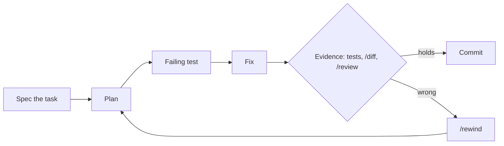
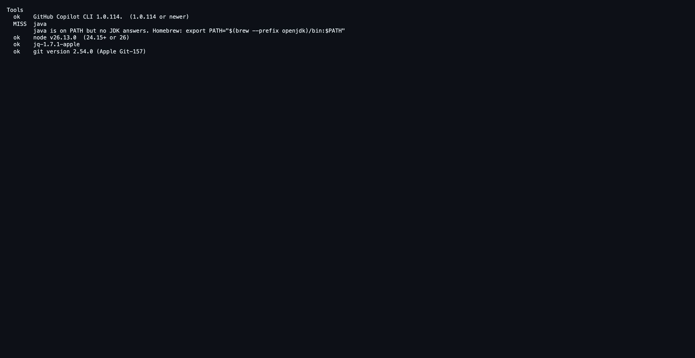
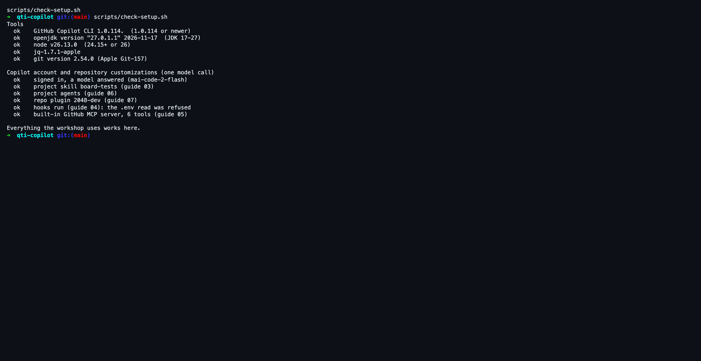

> 🌍 Číst v jazyce: [English](01-getting-started.md) | **Česky**

# 01 · Začínáme: instalace, první session, smyčka úrovně 5

> ⏱ 20 min (10 min nastavení + 3 min první session + 7 min [cvičení 0](exercises.cs.md)) · Dokumentace: [Installing Copilot CLI](https://docs.github.com/en/copilot/how-tos/copilot-cli/set-up-copilot-cli/install-copilot-cli) · [Plan mode](https://docs.github.com/en/copilot/how-tos/copilot-cli/cli-best-practices#plan-mode) · [Rolling back changes](https://docs.github.com/en/copilot/how-tos/copilot-cli/use-copilot-cli/roll-back-changes) · [Usage metrics fields](https://docs.github.com/en/copilot/reference/copilot-usage-metrics/copilot-usage-metrics) · Ověřeno na Copilot CLI 1.0.114

## Ve zkratce

**Potřebuješ:** Licenci Copilot Business nebo Enterprise, JDK 17–27, Node.js 24.15+ nebo 26, `git` a `jq`. Na Windows: WSL 2.

**K čemu to je:** Rozjede Copilot CLI v tomhle repu a naučí jednu smyčku, kterou opakuje každé další cvičení: plán, padající test, oprava, důkaz. Tak se pracuje na úrovni 5: kód píše Copilot a ty ho kontroluješ.

**Tři nejužitečnější použití:**

1. Oprav chybu, aniž bys psal kód: popiš ji, nech Copilot napsat padající test a opravu, přečti diff.
2. Vrať špatný krok za pár sekund přes `/rewind`, místo abys uklízel ručně.
3. Nech si každou změnu před commitem zkontrolovat přes `/review`.

**Jak to funguje:**



## Nastavení (10 min, na začátku)

Potřebuješ seat Copilot Business nebo Enterprise se zapnutou politikou Copilot CLI, libovolné JDK
17–27 (toolchain JDK 21 si Gradle stáhne sám), Node.js 24.15+ nebo 26, `jq` a `git`. Na
Windows použij WSL 2: hooky jsou bash skripty.

Na macOS je `/usr/bin/java` jen zástupný program, který bez nainstalovaného JDK selže, a `openjdk`
z Homebrew se do `PATH` nepřidá. Buď nainstaluj Temurin (`brew install --cask temurin`), který se
zaregistruje sám, nebo přidej JDK z Homebrew do `PATH` v `~/.zshrc` a otevři nový terminál:
```bash
brew install openjdk
echo 'export PATH="$(brew --prefix openjdk)/bin:$PATH"' >> ~/.zshrc
```
Bez toho první `./gradlew` v session selže a Copilot začne hledat JDK mimo repozitář a žádat
o přístup k cestám.

1. **Nainstaluj CLI.** Minimum je 1.0.114; CLI se při startu aktualizuje samo. Homebrew, WinGet
   a instalační skript najdeš na [stránce o instalaci](https://docs.github.com/en/copilot/how-tos/copilot-cli/set-up-copilot-cli/install-copilot-cli).
   ```bash
   npm install -g @github/copilot
   copilot --version                 # GitHub Copilot CLI 1.0.114.   (or newer)
   ```
2. **Přihlas se** účtem, který má seat Copilotu ([autentizace](https://docs.github.com/en/copilot/how-tos/copilot-cli/set-up-copilot-cli/authenticate-copilot-cli)).
   Exportovaný `COPILOT_GITHUB_TOKEN`, `GH_TOKEN` nebo `GITHUB_TOKEN` přebije uložené přihlášení.
   ```bash
   copilot login                                        # browser flow; over SSH: --device-code
   env | grep -E '^(COPILOT_GITHUB|GH|GITHUB)_TOKEN='   # prints nothing
   ```
3. **Naklonuj, sestav, zkontroluj.** První běh `./gradlew` stáhne Gradle a, pokud chybí, JDK 21.
   Oba příkazy `copilot` běží mimo session a nic nestojí.
   ```bash
   git clone https://github.com/klesajos/qti-copilot && cd qti-copilot
   java -version; node --version; jq --version   # 17–27, v24.15+ or v26, any
   ./gradlew build                               # BUILD SUCCESSFUL (13 engine + 5 API tests)
   npm ci                                        # eval tooling for guide 09
   (cd web && npm ci && npm test)                # Tests  7 passed (7)
   copilot instruction list                      # three files under .github/
   copilot skill list                            # "Project skills:" lists board-tests
   ```
4. **Spouštěj přes launcher:** `scripts/copilot-ws.sh`. Je to `copilot` s předem schváleným Gradle
   wrapperem, `npm test` a `npm run` a se zakázaným `.env`; další přepínače předá dál.
   Copilot CLI nemá commitnutý soubor s oprávněními, proto přepínače při spuštění ([08](08-permissions-sandbox.cs.md)).
5. **Důvěřuj složce.** U `Confirm folder trust` zvol **Yes, and remember this folder for
   future sessions**. Samotné **Yes** platí pro jednu session; **No (Esc)** Copilota zavře. Důvěra
   načte hooky repa (`.github/hooks/hooks.json`), jeho nastavení pluginů
   (`.github/copilot/settings.json`) a `.mcp.json` workspace
   ([dokumentace](https://docs.github.com/en/copilot/how-tos/copilot-cli/set-up-copilot-cli/configure-copilot-cli)).
   Skripty hooků běží s tvými oprávněními: v repu, které neznáš, si nejdřív přečti
   `.github/hooks/`. Běh `copilot -p` se zeptat nemůže: v nedůvěryhodné složce je přeskočí,
   pokud nepředáš `--trust-folder`.
6. **Zkontroluj nastavení:** `scripts/check-setup.sh`. Ověří nástroje a pak jedním voláním modelu
   dokáže, že funguje seat, model, skill, agenti, plugin, hooky a vestavěný MCP server (asi 20 s).
   Každý řádek `MISS` uvádí pravděpodobnou příčinu. Politiku organizace během workshopu nezměníš:
   cvičení, které blokuje, přeskoč a pokračuj dál.
   ```
   Copilot account and repository customizations (one model call)
     ok    signed in, a model answered (<model-id>)
     ok    project skill board-tests (guide 03)
     ok    project agents (guide 06)
     ok    repo plugin 2048-dev (guide 07)
     ok    hooks run (guide 04): the .env read was refused
     ok    built-in GitHub MCP server, 6 tools (guide 05)
   ```

   <details>
   <summary>Snímky z posledního zkušebního běhu (2026-11-23)</summary>

   *Zástupný program macOS, žádné JDK v `PATH`: `MISS java`*

   

   *Po opravě JDK: každý řádek `ok`*

   

   </details>

## První session (3 min, před cvičením 0)

V kořenu repa spusť `scripts/copilot-ws.sh` a napiš tyhle příkazy. Odpovídají na otázku „Co tohle
repo načetlo?“ `/env` vypisuje na časovou osu (PgUp roluje); ostatní otevřou obrazovku, kterou zavře `Esc`.

| Příkaz | Ukazuje | Co čekat tady |
|---------|-------|-------------|
| `/env` | Všechno načtené, po blocích: Custom Instructions, MCP Servers, Skills, Custom Agents, Plugins, Hooks, Extensions | Tři soubory s instrukcemi, `github-mcp-server (connected, builtin)`, `board-tests (Project)`, `build-test (Plugin)`, čtyři agenty, `2048-dev (1.0.0)`, jeden řádek Hooks na každou událost |
| `/instructions` | Soubory s instrukcemi, každý s přepínačem pro tuhle session | `3/3 enabled`: `.github/copilot-instructions.md`, `api.instructions.md`, `engine.instructions.md` |
| `/skills` | Správce skillů | `board-tests` (štítek `Repository`), `build-test` (štítek `Plugin-contributed`; spustíš ho jako `/2048-dev:build-test`), tvoje osobní (`User`) |
| `/agent` | Výběr agenta | `Default`, `board-test-writer · project`, `game-explorer · plugin`, `kotlin-reviewer · project`, `workshop-tutor · project`. Jako argument se agent z pluginu píše `/agent 2048-dev:game-explorer` |

## Smyčka úrovně 5

V tomhle workshopu kód generuješ, nepíšeš ho, a přesto za něj ručíš: úroveň 5 nebo vyšší na škále
z [Using AI to Contribute to Open Source](https://www.visidata.org/blog/2026/ai/).

| Úroveň | Název v příspěvku | Čteš | Na základě důkazů přijímáš |
|-------|------------------|----------|----------------------|
| 5 | Bots coded, human understands completely | Každý řádek diffu | Nic |
| 6 | Bots coded, human understands mostly | Rizikové části diffu a testy | Zbytek diffu |
| 7 | Human specced, bots coded | Plán, testy, nálezy z review | Většinu kódu |
| 8 | Bots planned, human approved | Výsledek | Plán a kód |

Cvičení běží na úrovni 5: malé diffy, přečtené celé. Smyčka je na každé úrovni stejná; vyšší
úroveň jen dovolí, aby krok 5 nahradil víc čtení. `<test>` je `./gradlew :engine:test`,
`./gradlew :api:test` nebo `cd web && npm test`.

1. **Začni načisto, přes launcher:** `git status --short` nevypíše nic, potom
   `git switch -c <branch>` a `scripts/copilot-ws.sh`. `/diff` pak ukazuje jen tuhle změnu.
2. **Naplánuj.** Napiš `/plan <spec>`. Specifikace pojmenuje chování, očekávaný výsledek, omezení
   a příkaz, který to prokáže. V patičce je `Plan`: CLI samo blokuje úpravy ve workspace
   a plán se ukládá do `plan.md` pod `~/.copilot/session-state/<session-id>/`. U
   `Plan Ready for Review` stiskni `Ctrl+E` a přečti si celý plán: test jde před opravou, které
   soubory jmenuje, důkazem je příkaz.
   Zvol **Exit to Interactive execution mode without running the plan**: chceš se zastavit
   mezi červenou a zelenou. Když chceš plán opravit, pošli `/plan <what is wrong>`; menu se vrátí.
   `Esc` v menu tě nechá v režimu Plan; `Shift+Tab` přepíná režimy.
3. **Červená: nejdřív padající test.** Na úpravy se CLI ptá (`Update file`, `Create file`): odpověz
   **1. Yes**. `<test>` běží bez ptaní; červená vypadá jako `✗ Shell … Failed with exit code 1`,
   `Ctrl+O` rozbalí výstup. Uznej jen selhání aserce, ne chybu kompilace nebo Spring kontextu.
   > *„Udělej jen testovací krok plánu. Spusť `<test>` a ukaž mi název padajícího testu a
   > hlášku jeho aserce. Opravu zatím nepiš.“*
4. **Zelená: implementuj.**
   > *„Teď udělej nejmenší změnu, se kterou tenhle test projde. Spusť `<test>` a nahlas počty
   > prošlých a spadlých testů.“*
5. **Důkazy**, posbírané dřív, než začneš číst.
   - **Testy:** počty z kroku 4. Když agent skončí s necommitnutými změnami pod
     `engine/`, `api/` nebo `web/src/`, hook `agentStop` pustí danou sadu znovu a při červené vypíše
     `run-tests hook: tests are failing in: ...`; žádná zpráva znamená zelenou ([04](04-hooks.cs.md)).
   - **`/diff`** otevře prohlížeč změny, včetně nových souborů; `Esc` ho zavře. Objevit se smí
     jen soubory z plánu. Na úrovni 5 ho přečti celý.
   - **[`/review`](https://docs.github.com/en/copilot/how-tos/copilot-cli/use-copilot-cli/agentic-code-review)**
     na změnu pustí agenta pro code review (v našem běhu 42 s, asi 1,8 AI kreditu). Nález je
     vstup: rozhoduješ ty a odpovíš na něj promptem.
6. **Když se to nepovedlo, vrať to.** `/rewind` nebo dvakrát `Esc` na prázdném promptu: vyber kolo,
   potom **Conversation + files**, potom Enter na seznamu souborů. Vrátí soubory, které Copilot
   změnil, do stavu před tím promptem (soubor, který vytvořil, smaže), přeskočí soubory, které
   jsi mezitím upravil ty, a nejde to vzít zpět. Prompt toho kola se vrátí do vstupního řádku:
   zuž ho (jmenuj soubor a funkci, zbytek zakaž) nebo ho smaž přes `Ctrl+C`.
7. **Commitni**, jakmile důkazy sedí: `! git add -A && git commit -m "<what and why>"`.
   Úvodní `!` spustí shellový příkaz přímo: žádný agent, žádné schvalování, žádné kredity.
   Potom `/new`: další úkol začíná s čistým kontextem.

### Řešený příklad: tah naprázdno, který přidá dlaždici

`GameService.move` uloží výsledek `board.move(direction)` do `changed`, ignoruje ho a vždy
zavolá `board.spawnRandom()`. Zmáčkni směr, který ničím nepohne, a objeví se dlaždice. Build
je zelený, protože to žádný test nepokrývá. Specifikace pro krok 2:

> */plan Bug: tah, který nic nezmění, přesto přidá dlaždici. GameService.move ignoruje
> Boolean vrácený z board.move(direction) a vždy zavolá board.spawnRandom(). Očekávané chování:
> po tahu, který nic nezmění, jsou mřížka i skóre stejné jako předtím a žádná dlaždice
> nepřibude. Po tahu, který desku změní, přibude právě jedna dlaždice, jako dnes.
> Omezení: nejdřív padající test, pod api/; test nesmí záviset na náhodných dlaždicích; v engine/
> nic neměň; pokud test potřebuje známou výchozí desku, navrhni nejmenší šev.
> Důkaz: ./gradlew :api:test.*

V plánu zkontroluj šev: `GameService` vytváří desky náhodným `Board.newGame()`, takže test
potřebuje cestu dovnitř. Parametr konstruktoru s výchozí hodnotou je v pořádku; veřejný setter
nebo endpoint jen pro testy ne.

Náš běh (headless, tahle specifikace plus kroky 3 a 4 jako jeden prompt `copilot -p`, 1 min 43 s):
`5 passed, 1 failed` na aserci mřížky, potom `if (changed)` kolem volání, které přidává dlaždici, a parametr
konstruktoru `() -> Board`, potom `6 passed, 0 failed`. Review referenčního diffu chtělo
pravidlo v `engine/`. Odpověz pravidlem repa: o tom, co se děje kolem tahu, rozhoduje `api`.

Referenční diff: [solutions/ex0.patch](solutions/ex0.patch). Teď to udělej sám: cvičení 0 v
[exercises.cs.md](exercises.cs.md). Když přečteš každý změněný řádek, pracuješ na úrovni 5.

## Co počítají metriky využití

Organizace vidí používání Copilot **CLI** po uživatelích. Pole pro CLI v
[referenci metrik využití](https://docs.github.com/en/copilot/reference/copilot-usage-metrics/copilot-usage-metrics#copilot-cli-metrics-fields):

- `totals_by_cli`, po dnech: `session_count` (počet různých spuštěných CLI sessions),
  `request_count` (tvoje prompty plus automatická navazující volání agenta), `prompt_count`
  (prompty, příkazy nebo dotazy, které jsi spustil) a součty tokenů promptů a výstupů.
- `used_cli`, po uživatelích a dnech: jestli jsi CLI použil. `daily_active_cli_users`, po organizacích.
- `copilot_feature_engagement`, v 28denním reportu: započítá tě pro `copilot_cli` po použití
  aspoň ve dvou různých dnech.
- Používání CLI v grafech dashboardu využití není; dashboard dopadu ho ukazuje jen jako
  feature engagement. Sessions, požadavky a tokeny jsou v API a v exportech, kde
  `totals_by_client` uvádí `copilot_cli`, `jetbrains`, `copilot_sdk` a `cloud_agent` jako
  samostatné klienty. Jak se který způsob práce počítá: [11 · IDE a vzdálená práce](11-ide-remote.cs.md).

> 🔷 **Jen Copilot:** zdokumentované schéma má pole `used_cli` po uživatelích a dnech. Dokumentace
> analytiky Claude Code uvádí využití a útratu po uživatelích, ale žádný takový denní příznak.

## Když něco nefunguje

- **`copilot: command not found` po úspěšné instalaci** → otevři nový terminál. Se správcem
  verzí Node najdi binárku přes `npm prefix -g` a přegeneruj shimy (`mise reshim`).
- **Přihlášení funguje, ale seznam modelů je špatný nebo prázdný** → přihlášení přebíjí proměnná
  s tokenem. Zruš `COPILOT_GITHUB_TOKEN`, `GH_TOKEN` a `GITHUB_TOKEN`, restartuj, zkontroluj přes `/user`.
- **Žádné hooky, žádný `/2048-dev:build-test`** → nejsi v kořenu repa
  (`git rev-parse --show-toplevel`); v běhu s `-p` chybí `--trust-folder`.
- **Copilot se ptá před každým `./gradlew`** → spouštěj `scripts/copilot-ws.sh`, ne `copilot`.

Dál: [02 · Vlastní instrukce](02-custom-instructions.cs.md)
