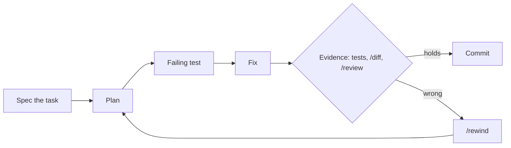

> 🌍 Read this in: **English** | [Česky](01-getting-started.cs.md)

# 01 · Getting started: install, first session, the level-5 loop

> ⏱ 20 min (10 min setup + 3 min first session + 7 min [exercise 0](exercises.md)) · Docs: [Installing Copilot CLI](https://docs.github.com/en/copilot/how-tos/copilot-cli/set-up-copilot-cli/install-copilot-cli) · [Plan mode](https://docs.github.com/en/copilot/how-tos/copilot-cli/cli-best-practices#plan-mode) · [Rolling back changes](https://docs.github.com/en/copilot/how-tos/copilot-cli/use-copilot-cli/roll-back-changes) · [Usage metrics fields](https://docs.github.com/en/copilot/reference/copilot-usage-metrics/copilot-usage-metrics) · Verified on Copilot CLI 1.0.114

## In short

**You need:** A Copilot Business or Enterprise seat, JDK 17–27, Node.js 24.15+ or 26, `git` and `jq`. On Windows: WSL 2.

**What it is for:** Gets Copilot CLI running in this repo and teaches the one loop every later exercise repeats: plan, failing test, fix, evidence. That loop is how you work at level 5, where Copilot writes the code and you check it.

**Three uses that pay off most:**

1. Fix a bug without typing code: describe it, let Copilot write the failing test and the fix, read the diff.
2. Undo a wrong turn in seconds with `/rewind` instead of cleaning up by hand.
3. Have every change reviewed with `/review` before you commit it.

**How it works:**



## Setup (10 min, at the start)

You need a Copilot Business or Enterprise seat with the Copilot CLI policy enabled, any JDK
17–27 (Gradle fetches the JDK 21 toolchain itself), Node.js 24.15+ or 26, `jq` and `git`. On
Windows use WSL 2: the hooks are bash scripts.

1. **Install the CLI.** 1.0.114 is the minimum; the CLI updates itself at start. Homebrew, WinGet
   and the install script are on the [install page](https://docs.github.com/en/copilot/how-tos/copilot-cli/set-up-copilot-cli/install-copilot-cli).
   ```bash
   npm install -g @github/copilot
   copilot --version                 # GitHub Copilot CLI 1.0.114.   (or newer)
   ```
2. **Log in** with the account that holds the Copilot seat ([authentication](https://docs.github.com/en/copilot/how-tos/copilot-cli/set-up-copilot-cli/authenticate-copilot-cli)).
   An exported `COPILOT_GITHUB_TOKEN`, `GH_TOKEN` or `GITHUB_TOKEN` overrides the stored login.
   ```bash
   copilot login                                        # browser flow; over SSH: --device-code
   env | grep -E '^(COPILOT_GITHUB|GH|GITHUB)_TOKEN='   # prints nothing
   ```
3. **Clone, build, check.** The first `./gradlew` run downloads Gradle and, if missing, JDK 21.
   The two `copilot` commands run outside a session and cost nothing.
   ```bash
   git clone https://github.com/klesajos/qti-copilot && cd qti-copilot
   java -version; node --version; jq --version   # 17–27, v24.15+ or v26, any
   ./gradlew build                               # BUILD SUCCESSFUL (13 engine + 5 API tests)
   npm ci                                        # eval tooling for guide 09
   (cd web && npm ci && npm test)                # Tests  7 passed (7)
   copilot instruction list                      # three files under .github/
   copilot skill list                            # "Project skills:" lists board-tests
   ```
4. **Start through the launcher:** `scripts/copilot-ws.sh`. It is `copilot` with the Gradle
   wrapper, `npm test` and `npm run` pre-approved and `.env` denied; extra flags pass through.
   Copilot CLI has no committed permissions file, hence launch flags ([08](08-permissions-sandbox.md)).
5. **Trust the folder.** At `Confirm folder trust` choose **Yes, and remember this folder for
   future sessions**. Plain **Yes** holds for one session; **No (Esc)** closes Copilot. Trust
   loads the repo's hooks (`.github/hooks/hooks.json`), its plugin settings
   (`.github/copilot/settings.json`) and a workspace `.mcp.json`
   ([docs](https://docs.github.com/en/copilot/how-tos/copilot-cli/set-up-copilot-cli/configure-copilot-cli)).
   Hook scripts run with your permissions: in a repo you do not know, read `.github/hooks/`
   first. A `copilot -p` run cannot ask: in an untrusted folder it skips them unless you pass
   `--trust-folder`.
6. **Check the setup:** `scripts/check-setup.sh`. It checks the tools, then makes one model call
   that proves the seat, a model, the skill, the agents, the plugin, the hooks and the built-in
   MCP server (about 20 s). Every `MISS` line names the likely cause. An organisation policy cannot
   be changed during the workshop: skip the exercise it blocks and carry on.
   ```
   Copilot account and repository customizations (one model call)
     ok    signed in, a model answered (<model-id>)
     ok    project skill board-tests (guide 03)
     ok    project agents (guide 06)
     ok    repo plugin 2048-dev (guide 07)
     ok    hooks run (guide 04): the .env read was refused
     ok    built-in GitHub MCP server, 6 tools (guide 05)
   ```

## First session (3 min, before exercise 0)

Start `scripts/copilot-ws.sh` in the repo root and type these. They answer "what did this repo
load?" `/env` prints to the timeline (PgUp scrolls); the others open a screen that `Esc` closes.

| Command | Shows | Expect here |
|---------|-------|-------------|
| `/env` | Everything loaded, in blocks: Custom Instructions, MCP Servers, Skills, Custom Agents, Plugins, Hooks, Extensions | The three instruction files, `github-mcp-server (connected, builtin)`, `board-tests (Project)`, `build-test (Plugin)`, four agents, `2048-dev (1.0.0)`, one Hooks line per event |
| `/instructions` | The instruction files, each with a switch for this session | `3/3 enabled`: `.github/copilot-instructions.md`, `api.instructions.md`, `engine.instructions.md` |
| `/skills` | The skills manager | `board-tests` (label `Repository`), `build-test` (label `Plugin-contributed`; run it as `/2048-dev:build-test`), your personal ones (`User`) |
| `/agent` | The agent picker | `Default`, `board-test-writer · project`, `game-explorer · plugin`, `kotlin-reviewer · project`, `workshop-tutor · project`. As an argument the plugin agent is `/agent 2048-dev:game-explorer` |

## The level-5 loop

In this workshop you generate code, you do not type it, and you still vouch for it: level 5 or higher on
the scale in [Using AI to Contribute to Open Source](https://www.visidata.org/blog/2026/ai/).

| Level | Name in the post | You read | You take on evidence |
|-------|------------------|----------|----------------------|
| 5 | Bots coded, human understands completely | Every line of the diff | Nothing |
| 6 | Bots coded, human understands mostly | The risky hunks and the tests | The rest of the diff |
| 7 | Human specced, bots coded | The plan, the tests, the review findings | Most of the code |
| 8 | Bots planned, human approved | The result | The plan and the code |

The exercises run at level 5: small diffs, read in full. The loop is the same at every level; a
higher level only lets step 5 replace more of the reading. `<test>` is `./gradlew :engine:test`,
`./gradlew :api:test` or `cd web && npm test`.

1. **Start clean, through the launcher:** `git status --short` prints nothing, then
   `git switch -c <branch>` and `scripts/copilot-ws.sh`. Then `/diff` shows this change only.
2. **Plan.** Type `/plan <spec>`. A spec names the behaviour, the expected result, the
   constraints and the command that proves it. The footer shows `Plan`: the CLI itself blocks
   edits to the workspace, and the plan goes to `plan.md` under
   `~/.copilot/session-state/<session-id>/`. At `Plan Ready for Review` press `Ctrl+E` and read
   the full plan: the test comes before the fix, the files it names, the proof is a command.
   Choose **Exit to Interactive execution mode without running the plan**: you want to stop
   between red and green. To correct the plan, send `/plan <what is wrong>`; the menu returns.
   `Esc` at the menu leaves you in Plan mode; `Shift+Tab` cycles the mode.
3. **Red: the failing test first.** Edits ask (`Update file`, `Create file`): answer **1. Yes**.
   `<test>` runs without asking; red shows as `✗ Shell … Failed with exit code 1`, `Ctrl+O`
   expands the output. Accept only an assertion failure, not a compile or Spring context error.
   > *"Do the test step of the plan only. Run `<test>` and show me the failing test's name and
   > its assertion message. Do not write the fix yet."*
4. **Green: implement.**
   > *"Now make the smallest change that makes this test pass. Run `<test>` and report the pass
   > and fail counts."*
5. **Evidence**, collected before you read.
   - **Tests:** the counts from step 4. When the agent stops with uncommitted changes under
     `engine/`, `api/` or `web/src/`, the `agentStop` hook reruns that suite and prints
     `run-tests hook: tests are failing in: ...` on red; no message means green ([04](04-hooks.md)).
   - **`/diff`** opens a viewer of the change, new files included; `Esc` closes it. Only files
     from the plan may appear. At level 5 read it all.
   - **[`/review`](https://docs.github.com/en/copilot/how-tos/copilot-cli/use-copilot-cli/agentic-code-review)**
     runs the code review agent on it (42 s, about 1.8 AI credits in our run). A finding is
     input: you decide and answer it by prompt.
6. **Rewind if it went wrong.** `/rewind`, or `Esc` twice on an empty prompt: pick the turn, then
   **Conversation + files**, then Enter on the file list. It restores the files Copilot changed
   to their state before that prompt (a file it created is deleted), skips files you edited
   since, and cannot be undone. The prompt of that turn returns to the input line: make it
   narrower (name the file and the function, forbid the rest), or clear it with `Ctrl+C`.
7. **Commit** once the evidence holds: `! git add -A && git commit -m "<what and why>"`. A
   leading `!` runs a shell command directly: no agent, no approval, no credits. Then `/new`:
   the next task starts with a fresh context.

### Worked example: the no-op move that spawns a tile

`GameService.move` stores the result of `board.move(direction)` in `changed`, ignores it and
always calls `board.spawnRandom()`. Press a direction that moves nothing and a tile appears. The
build is green because no test covers it. The spec for step 2:

> */plan Bug: a move that changes nothing still spawns a tile. GameService.move ignores the
> Boolean returned by board.move(direction) and always calls board.spawnRandom(). Expected:
> after a move that changes nothing, the grid and the score are the same as before and no tile
> is added. After a move that changes the board, exactly one tile is added, as today.
> Constraints: failing test first, under api/; the test must not depend on random tiles; change
> nothing in engine/; if the test needs a known starting board, propose the smallest seam.
> Proof: ./gradlew :api:test.*

In the plan, check the seam: `GameService` creates boards with the random `Board.newGame()`, so
the test needs a way in. A constructor parameter with a default is fine; a public setter or a
test-only endpoint is not.

Our run (headless, this spec plus steps 3 and 4 as one `copilot -p` prompt, 1 min 43 s):
`5 passed, 1 failed` on the grid assertion, then `if (changed)` around the spawn call and a
`() -> Board` constructor parameter, then `6 passed, 0 failed`. A review of the reference diff
wanted the rule in `engine/`. Answer with the repo's rule: `api` decides what happens around a move.

Reference diff: [solutions/ex0.patch](solutions/ex0.patch). Now do it yourself: exercise 0 in
[exercises.md](exercises.md). Read every changed line and you worked at level 5.

## What the usage metrics count

An organisation can see Copilot **CLI** usage per user. The CLI fields in the
[usage metrics reference](https://docs.github.com/en/copilot/reference/copilot-usage-metrics/copilot-usage-metrics#copilot-cli-metrics-fields):

- `totals_by_cli`, per day: `session_count` (distinct CLI sessions started), `request_count`
  (your prompts plus the agent's automated follow-up calls), `prompt_count` (prompts, commands or
  queries you ran), and the prompt and output token sums.
- `used_cli`, per user and day: whether you used the CLI. `daily_active_cli_users`, per org.
- `copilot_feature_engagement`, in the 28-day report: counts you for `copilot_cli` after use on
  at least two distinct days.
- The usage dashboard charts do not include CLI usage; the impact dashboard shows it only as
  feature engagement. Sessions, requests and tokens are in the API and the exports, where
  `totals_by_client` lists `copilot_cli`, `jetbrains`, `copilot_sdk` and `cloud_agent` as separate
  clients. What each way of working counts as: [11 · IDE and remote](11-ide-remote.md).

> 🔷 **Copilot only:** the documented schema has a per-user, per-day `used_cli` field. Claude
> Code's analytics docs list per-user usage and spend, but no such daily flag.

## Troubleshooting

- **`copilot: command not found` after a successful install** → open a new terminal. With a
  Node version manager, find the binary with `npm prefix -g` and rebuild the shims (`mise reshim`).
- **Login works, but the model list is wrong or empty** → a token variable overrides the login.
  Unset `COPILOT_GITHUB_TOKEN`, `GH_TOKEN` and `GITHUB_TOKEN`, restart, check with `/user`.
- **No hooks, no `/2048-dev:build-test`** → you are not in the repo root
  (`git rev-parse --show-toplevel`); in a `-p` run, `--trust-folder` is missing.
- **Copilot asks before every `./gradlew`** → start `scripts/copilot-ws.sh`, not `copilot`.

Next: [02 · Custom instructions](02-custom-instructions.md)
