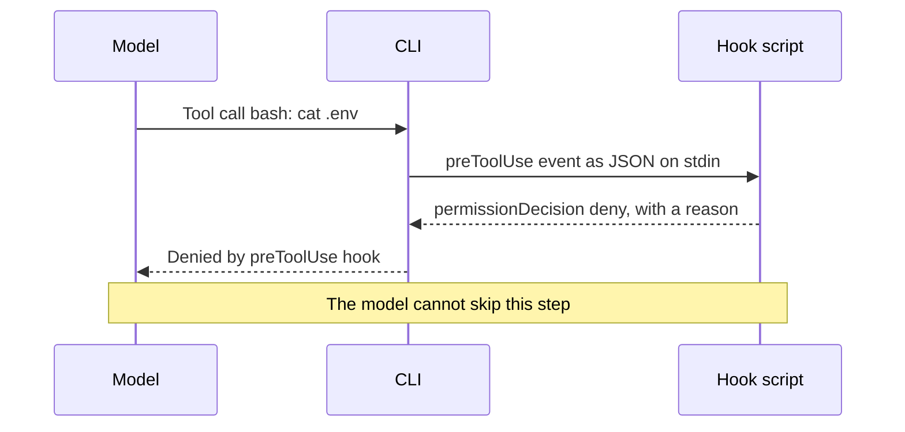

> 🌍 Read this in: **English** | [Česky](04-hooks.cs.md)

# 04 · Hooks

> ⏱ 25 min (5 payload lab + 5 deny demo + 15 exercise 3) · Docs: [Hooks for GitHub Copilot](https://docs.github.com/en/copilot/concepts/customizations/hooks) · [GitHub Copilot hooks reference](https://docs.github.com/en/copilot/reference/hooks-reference) · [Using hooks with GitHub Copilot CLI](https://docs.github.com/en/copilot/how-tos/copilot-cli/customize-copilot/use-hooks) · Verified on Copilot CLI 1.0.114

## In short

**You need:** bash and `jq`, Copilot started from the repo root in a trusted folder. On Windows: WSL 2.

**What it is for:** A hook is a script that the CLI itself runs on an event, for example before every shell command. The model cannot skip it, so it is the place for rules that must hold every single time.

**Three uses that pay off most:**

1. Block dangerous or secret-leaking commands such as `rm -rf` or `cat .env` before they run.
2. Format every file Copilot edits, automatically.
3. Do not let the agent finish while the tests are red.

**How it works:**



## What is a hook?

A hook is a command that the CLI runs itself when an event happens: a session starts, a tool is
about to run, a tool has finished, the agent is about to stop. The CLI writes the event as JSON
to the command's stdin and reads at most one JSON object back from its stdout.

Instructions and skills are text in the context window, and the model may skip them. A hook runs
outside the model, every time, whatever the model decided. At level 5+ you generate code and no
longer read every tool call. The hooks do.

## What this example does

`.github/hooks/hooks.json` registers five scripts from `.github/hooks/scripts/`. All but
`run-tests.sh` need `jq`; without it they do nothing and the session continues.

| Event | Script | What it does | Can it block? |
|---|---|---|---|
| `sessionStart` | `git-context.sh` | Tells the model the branch and the uncommitted files | No. It adds context |
| `preToolUse` | `block-destructive.sh` | Refuses `rm -rf`, `git reset --hard`, force-push, `git clean -f`, `git checkout -- .` | Yes, the tool call |
| `preToolUse` | `protect-secrets.sh` | Keeps `.env` files out of the session (shell and `view`) | Yes, the tool call |
| `postToolUse` | `format.sh` | Runs Prettier on edited files in `web/src/` and tells the model | No. The edit already happened |
| `agentStop` | `run-tests.sh` | Runs the tests of the parts that have uncommitted changes | No, it warns. Exercise 3 makes it block |

## Lab: dump the payload first

The payload shape depends on the tool and on the model. Look at it before you write a script.

1. Create `.github/hooks/payload-dump.json`. Every `*.json` in that directory is loaded.
   ```json
   {
     "version": 1,
     "hooks": {
       "preToolUse": [
         { "type": "command", "bash": "mkdir -p .github/hooks/logs; (cat; echo) >> .github/hooks/logs/preToolUse.jsonl; exit 0", "cwd": ".", "timeoutSec": 5 }
       ]
     }
   }
   ```
   No `matcher`, so it fires for every tool. `(cat; echo)` appends the payload as one line.
   `exit 0` matters: a `preToolUse` hook that exits non-zero denies the tool call.
2. From the repo root, run one session. Hook files are read when the CLI starts.
   ```bash
   copilot -p "Do exactly these three things, in order, then stop: (1) read the file README.md with the file view tool; (2) run the shell command 'git status --short'; (3) create a new file named .github/hooks/logs/note.txt containing the single word alpha. Do not do anything else." \
     --trust-folder --no-ask-user --allow-tool='write'
   ```
3. Print what each tool received. `<repo>` stands for the absolute path of the repo.
   ```bash
   jq -c '{toolName, toolArgs}' .github/hooks/logs/preToolUse.jsonl
   ```
   ```json
   {"toolName":"view","toolArgs":{"path":"<repo>/README.md"}}
   {"toolName":"bash","toolArgs":{"command":"git status --short","description":"Check short git status"}}
   {"toolName":"bash","toolArgs":{"command":"mkdir -p .github/hooks/logs && printf alpha > .github/hooks/logs/note.txt","description":"Create note.txt containing alpha"}}
   {"toolName":"apply_patch","toolArgs":"*** Begin Patch\n*** Add File: <repo>/.github/hooks/logs/note.txt\n+alpha\n*** End Patch\n"}
   ```
4. Read three facts off it. Your lines may differ, because the model chooses the tools.
   - **`toolArgs` is an object for `bash` and `view`, and a raw patch string for `apply_patch`.**
     The string is not JSON. `jq '.toolArgs.path'` fails on it.
   - **GPT-family models edit through `apply_patch`**, not `edit` / `create` (so did the MAI
     model in this run). A matcher of `edit|create` never fires for them, and nothing tells you.
   - **Shell redirection bypasses edit matchers.** The third line writes a file through `bash`
     (refused here: the run pre-approves only `write`). A hook on the edit tools never sees it.
5. Clean up: `rm .github/hooks/payload-dump.json && rm -r .github/hooks/logs`

## The files, line by line

### `.github/hooks/hooks.json`

Same envelope as your dump file: `hooks` maps an event name (camelCase) to a list of flat
entries. The payload does not name its event; a script knows it from where it is registered.
`"type": "command"` (the default) runs a shell command.

- `"matcher"`: a regex on the tool name, compiled as `^(?:PATTERN)$`, so it must match the whole
  name: `bash|powershell` for `block-destructive.sh`, `bash|powershell|view` for
  `protect-secrets.sh`, `edit|create|str_replace_editor|apply_patch` for `format.sh` (lab
  fact 2). `sessionStart` and `agentStop` are not about a tool and have none.
- `"bash"` runs relative to `cwd`. `"cwd": "."` is the repository root. Start `copilot` there.
- `"timeoutSec"`: default 30. Here 10 for the guards, 60 for the formatter, 300 for the tests.
- Both guards match a shell call. Both run, and any `deny` wins.

### `.github/hooks/scripts/protect-secrets.sh`

The script from line 17 on. The lines before it are covered by the first two bullets.

```bash
# What the tool is about to touch: a path for the file tools, a command for the shell.
target=$(printf '%s' "$input" | jq -r '
    (.toolArgs // {})
    | if type == "string" then (fromjson? // {}) else . end
    | if type == "object" then (.path // .command // "") else "" end' 2>/dev/null)

# Matches .env and .env.local, but not .envrc or environment.ts.
if printf '%s' "$target" | grep -Eq '(^|[^[:alnum:]_])\.env(\.[[:alnum:]_-]+)?([^[:alnum:]_.-]|$)'; then
    jq -cn '{permissionDecision: "deny", permissionDecisionReason: "protect-secrets hook: .env files hold secrets and stay out of the session. Ask the user for the specific value you need."}'
fi

exit 0
```

- Line 8, `set -uo pipefail` without `-e`: a `preToolUse` hook that exits non-zero denies the
  tool call. With `-e`, a failure outside an `if`, such as `jq` on a broken payload, would deny it.
- Lines 10–15: `input=$(cat)` reads the payload from stdin. Without `jq` the guard switches
  itself off, says so on stderr and exits 0: you learn it is inactive, and no call is denied.
- The `jq` expression accepts three shapes: an object is used as is, a JSON-encoded string is
  parsed with `fromjson`, anything else (a patch string) becomes empty. `.path // .command`
  covers both tools: `view` carries a `path`, the shell a `command`.
- The regex: `.env` at the start or after a non-word character, an optional suffix such as
  `.local`, then the end or a character that cannot continue a file name.
- The deny is exit 0 plus one JSON object. `permissionDecisionReason` goes to the model, so write
  it as an instruction: what to do instead. No output and exit 0 means "no opinion".
- It matches text: `cat .e*` passes, `grep -n .env .gitignore` is denied. It is a guard rail. The
  boundary is the sandbox ([08](08-permissions-sandbox.md)). The hook exists because
  `--deny-tool='read(.env)'` stops only `view`, not `cat .env` in the shell.

### The other four

- **`git-context.sh`** (`sessionStart`) prints the branch and up to 10 uncommitted files as
  `{"additionalContext": "..."}`. It is a snapshot from session start and is not refreshed.
- **`block-destructive.sh`** (`preToolUse`): the same skeleton with five regex rules. Each reason
  names the safe route, such as `git push --force-with-lease`. `rm -rf` of build output passes.
- **`format.sh`** (`postToolUse`) takes `.path` from an object, or the `*** Add File:` /
  `*** Update File:` headers from a patch string, and runs Prettier on `web/src/` (needs
  `cd web && npm ci`). Its `additionalContext` tells the model to re-read the now changed file.
- **`run-tests.sh`** (`agentStop`) fires after every turn, also after a plain question. It runs
  `./gradlew test` if `engine/` or `api/` has uncommitted changes and `npm test` if `web/src/`
  has. On failure it writes one line to stderr and exits 2: a warning. The turn still ends.

## Create your own, step by step

1. Dump the payload of the event you want (the lab above). Write against what you saw.
2. Write `.github/hooks/scripts/my-hook.sh` and `chmod +x` it. It starts in the repo root. Read
   stdin, accept `toolArgs` as an object and as a string, print at most one JSON object, `exit 0`.
3. Register it in `hooks.json`, or in a new `*.json` next to it, with a `matcher` (tool events).
4. Test it with fake stdin, outside a session. This prints the deny object:
   ```bash
   echo '{"toolName":"bash","toolArgs":{"command":"cat .env"}}' | .github/hooks/scripts/protect-secrets.sh
   ```
5. Start a new session and run `/env`. Its `Hooks` block counts the hooks per event and names
   their files. As shipped: `preToolUse: 2 hooks (sources: .github/hooks/hooks.json (2))`.
6. Commit the JSON file and the script. Everyone who trusts the folder then runs them, so review
   a change in `.github/hooks/` like a change to CI.

## Try the demo

1. Start `copilot` in the repo root. At `Confirm folder trust` choose **Yes**: repo hooks need a trusted folder.
2. Paste:
   > *"Run exactly this one shell command and report in one sentence what happened, quoting any message you received: cat .env"*

3. The shell call fails before `cat` starts. The model receives this as the tool result:
   ```text
   Denied by preToolUse hook: protect-secrets hook: .env files hold secrets and stay out of the session. Ask the user for the specific value you need.
   ```

No `.env` file is needed: the hook judges the command text. `--allow-tool='shell'` does not lift the deny.

## Events and how a hook answers

| Event | Fires | `matcher` on | Answer: one JSON object on stdout, exit 0 |
|---|---|---|---|
| `sessionStart` | A session starts or resumes | — | `{"additionalContext": "..."}` is added to the session |
| `preToolUse` | Before each tool call | tool name | `{"permissionDecision": "deny", "permissionDecisionReason": "..."}`. Also `allow` and `ask`; `modifiedArgs` rewrites the call |
| `postToolUse` | After a successful tool call | tool name | `{"additionalContext": "..."}` is appended to the tool result; `modifiedResult` replaces it |
| `agentStop` | The main agent finishes a turn | — | `{"decision": "block", "reason": "..."}` starts another turn with `reason` as its prompt |

These are 4 of 14 events. Ideas for others: `notification` (desktop alert when Copilot waits for
you), `preCompact` (copy the transcript first), `sessionEnd` (log the run), `postToolUse` with
`"type": "http"` (audit trail). All events: [Hook events](https://docs.github.com/en/copilot/reference/hooks-reference#hook-events).

| Exit code | Every event | Exception: `preToolUse` |
|---|---|---|
| `0` | Stdout is parsed as the answer. Empty means no opinion | — |
| `2` | Only a warning: stderr is shown, the run continues | Denies the tool call |
| other non-zero | Logged and skipped | Denies: `Denied by preToolUse hook (hook errored)` |
| timeout | The hook is killed, the run continues | The tool call goes ahead. A slow guard is no guard |

So `agentStop` cannot block with an exit code, only with the JSON. Its payload has
`stop_hook_active`: `false` on a normal stop, `true` on the stop that follows a block. Use it to
block once. After 8 consecutive blocks the CLI ends the turn anyway. Debug text goes to stderr.

## Optional parameters

| Key or location | What it does |
|---|---|
| `powershell`, `command`, `env` | Command line for PowerShell; fallback command line for both shells; extra environment variables |
| `"type": "http"`, `"type": "prompt"` | POSTs the payload to an `https://` `url`; submits a text or slash command for you (`sessionStart` only, new interactive sessions only) |
| `"disableAllHooks": true` | In a hooks file: skips that file. In `.github/copilot/settings.json`: skips every hook except policy hooks |
| `~/.copilot/hooks/*.json`, `hooks:` in agent frontmatter, `hooks.json` in a plugin | Your personal hooks in every repo; hooks only while that agent is selected ([06](06-agents.md)); hooks for whoever enables the plugin ([07](07-plugins.md)) |

Full reference: [GitHub Copilot hooks reference](https://docs.github.com/en/copilot/reference/hooks-reference)

## Where it works

| Platform | Works? | Notes |
|---|---|---|
| Copilot CLI | ✅ | Everything in this guide |
| IntelliJ IDEA plugin | ⚠️ | Reads `.github/hooks/`. Published events: `userPromptSubmitted`, `preToolUse`, `postToolUse`, `errorOccurred`. `sessionStart` and `agentStop` are not among them, so expect `git-context.sh` and `run-tests.sh` to do nothing. See [11](11-ide-remote.md) |
| Copilot cloud agent | ⚠️ | Loads the same `.github/hooks/*.json` in every job on the repo. Only `bash` / `command` entries, `ask` becomes deny, `permissionRequest` and `notification` do not fire |

## Copilot vs Claude Code

Claude Code has the same mechanism under the same name: hooks in `.claude/settings.json` with
`PreToolUse`, `PostToolUse`, `Stop`, `SessionStart`. Policy hooks, agent-scoped hooks and hooks
in cloud runs exist in both. What differs: Copilot uses flat entries in `.github/hooks/*.json`
and a camelCase payload (`toolName`, `toolArgs`); Claude Code's payload is snake_case
(`tool_name`, `tool_input`). Copilot CLI also runs the hooks in a repo's `.claude/settings.json`,
on the matching events and with Claude Code's field names: such a repo runs both sets.

> 🔷 **Copilot only:** the `userPromptTransformed` event lets a hook rewrite the prompt text the
> model receives. Claude Code's `UserPromptSubmit` can only block the prompt or add context.

> 🔷 **Copilot only:** a `"type": "prompt"` hook submits a prompt or slash command when an
> interactive session starts. Claude Code's `SessionStart` hook can do that only in `-p` runs.

## Troubleshooting

- **Hook never runs, `/env` does not list it** → start a new session from the repo root
  (`git rev-parse --show-toplevel`). A `-p` run needs `--trust-folder`. Still missing: run `scripts/check-setup.sh` ([01](01-getting-started.md)).
- **Every shell command fails with `Denied by preToolUse hook (hook errored)`** → a
  `preToolUse` script exits non-zero. Run it with fake stdin and look for `set -e`.
- **A guard passes the fake-stdin test but not the session** → the matcher misses the real tool
  name, or `toolArgs` has another shape. Repeat the lab.
- **Every turn is slow** → `run-tests.sh` runs Gradle while `engine/` or `api/` is dirty. Commit.

Next: [05 · MCP](05-mcp.md) · Exercise 3: [exercises.md](exercises.md)
