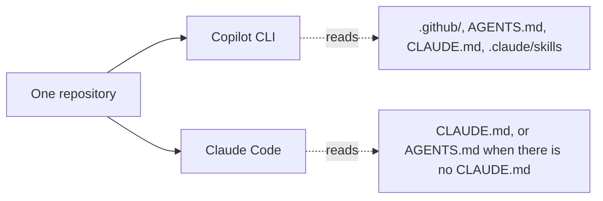

> 🌍 Číst v jazyce: [English](12-copilot-vs-claude.md) | **Česky**

# 12 · Copilot vs Claude Code: co je jen tady

> ⏱ 10 min (výklad + dotazy: projdi řádky Modely a Platforma GitHub a závěr; zbytek je reference) · Dokumentace: [Copilot customization cheat sheet](https://docs.github.com/en/copilot/reference/customization-cheat-sheet) · [Claude Code docs index](https://code.claude.com/docs/llms.txt) · Ověřeno na Copilot CLI 1.0.114 · Porovnáno 2026-11-21 s tehdejší dokumentací Claude Code; oba nástroje se mění každý měsíc, takže si řádek znovu ověř, než se podle něj rozhodneš

## Ve zkratce

**Potřebuješ:** Nic k instalaci: je to výklad. Pomůže, pokud jsi absolvoval workshop Claude Code.

**K čemu to je:** Ukáže, co má Copilot a Claude Code ne, co je stejná myšlenka pod jiným jménem a jak může jedno repo bez potíží sloužit oběma nástrojům.

**Tři nejužitečnější použití:**

1. Zjisti, které funkce jen pro Copilot se v týmu vyplatí: výběr modelů, napojení na GitHub, metriky.
2. Přenes si zvyky z Claude Code pomocí tabulky s mapováním názvů.
3. Zabraň tomu, aby repo, které čtou oba nástroje, posílalo stejné instrukce dvakrát.

**Jak to funguje:**

## Jen v Copilotu

Seřazeno podle toho, jak moc rozdíl pocítí vývojář. Kde má Claude Code částečnou
náhradu, prostřední sloupec uvádí jen to, co pořád chybí. „—“ = není součástí workshopu.

| Featura | Co přesně Claude Code chybí | V tomhle workshopu |
|---|---|---|
| **Modely** | | |
| [Modely od několika dodavatelů](https://docs.github.com/en/copilot/reference/ai-models/supported-models) v jednom výběru (`/model`, `--model <model-id>`) | Běží jen na modelech Claude. [Žádná gateway ho nesmí směrovat na model jiného dodavatele](https://code.claude.com/docs/en/llm-gateway) | [00](00-llm-basics.cs.md) |
| [Vlastní a lokální modely](https://docs.github.com/en/copilot/how-tos/copilot-cli/customize-copilot/add-llm-models): OpenAI-kompatibilní, Azure, Ollama, offline režim | Libovolný OpenAI-kompatibilní nebo Ollama endpoint a offline režim | [00](00-llm-basics.cs.md) |
| `--model auto` ([Copilot Fusion](https://docs.github.com/en/copilot/concepts/models/copilot-fusion)) | Router, který vybírá model pro každý prompt a přepne, když model narazí na rate limit. Nejblíž: `opusplan`, advisor, `--fallback-model` (jen při přetížení) ([dokumentace](https://code.claude.com/docs/en/model-config)) | [00](00-llm-basics.cs.md) |
| [`/rubber-duck`](https://docs.github.com/en/copilot/concepts/agent-capabilities/choosing-and-delegating-agent-work/getting-a-second-opinion): kritika tvého plánu nebo diffu od jiné rodiny modelů | Druhý názor od jiného dodavatele. Jeho [advisor](https://code.claude.com/docs/en/advisor) je vždycky jiný model Claude | [tahák](cheatsheet.cs.md) |
| Plan režim s vlastní úrovní úsilí: `planEffortLevel`, `/model plan` | Samostatné nastavení úrovně úsilí pro plan režim. `opusplan` dává plan režimu jen vlastní model ([dokumentace](https://code.claude.com/docs/en/model-config)) | [00](00-llm-basics.cs.md) |
| **Platforma GitHub** | | |
| [Vestavěný GitHub MCP server](https://docs.github.com/en/copilot/reference/copilot-cli-reference/cli-command-reference#built-in-mcp-servers): startuje při přihlášení, standardně read-only | GitHub server bez nastavování: přidáváš ho s tokenem nebo instaluješ plugin ([dokumentace](https://code.claude.com/docs/en/mcp)) | [05](05-mcp.cs.md) |
| [`/pr`](https://docs.github.com/en/copilot/how-tos/copilot-cli/use-copilot-cli/manage-pull-requests): vytvoření, oprava komentářů z review, konfliktů a CI, sloučení; záložky Issues a Pull requests | Jeden příkaz, který vyřeší i konflikty a sloučí pull request, ty záložky, patička se stavem CI. `/autofix-pr` pokrývá selhání CI a komentáře z review ([dokumentace](https://code.claude.com/docs/en/claude-code-on-the-web)) | — |
| [`/delegate`](https://docs.github.com/en/copilot/how-tos/copilot-cli/use-copilot-cli/delegate-tasks-to-cca): pošle běžící session cloud agentovi, který otevře draft PR | Odeslání běžící session z CLI (`claude --cloud` startuje novou; aplikace Desktop to umí), draft PR při předání, `--base` | [11](11-ide-remote.cs.md) |
| [Přiřazení issue Copilotovi](https://docs.github.com/en/copilot/how-tos/copilot-on-github/use-copilot-agents/kick-off-a-task); spuštění cloud agenta z [Jira, Teams, Linear, Azure Boards](https://docs.github.com/en/copilot/concepts/agent-capabilities/choosing-and-delegating-agent-work/about-copilot-integrations) | Identita, které jde issue přiřadit: stavíš ji jako [Actions workflow](https://code.claude.com/docs/en/github-actions). Vstupní bod z těch čtyř nástrojů (jen Slack) | [11](11-ide-remote.cs.md) |
| CLI v GitHub Actions na vestavěném [`GITHUB_TOKEN`](https://docs.github.com/en/copilot/how-tos/copilot-cli/use-copilot-cli-in-actions) | Autentizace přes `GITHUB_TOKEN` a účtování na githubovou organizaci: jeho Action potřebuje přihlašovací údaj od Anthropicu | [10](10-orchestration.cs.md) |
| [Copilot Memory](https://docs.github.com/en/copilot/concepts/prompting-and-context/copilot-memory): fakta o repozitáři uložená na GitHubu (preview) | Fakta sdílená s týmem, cloud agentem a code review bez commitu. Jeho auto memory je jen na daném stroji ([dokumentace](https://code.claude.com/docs/en/memory)) | — |
| [Copilot Spaces](https://docs.github.com/en/copilot/concepts/prompting-and-context/spaces) přes vestavěné MCP nástroje `list_copilot_spaces`, `get_copilot_space` | Sdílené, kurátorované úložiště kontextu. Má konektory a commitnutý `CLAUDE.md` | [05](05-mcp.cs.md) |
| **Governance, účtování a metriky** | | |
| [Metriky CLI po uživatelích](https://docs.github.com/en/copilot/reference/copilot-usage-metrics/copilot-usage-metrics) pro adminy: `used_cli`, sessions, požadavky, tokeny | Denní pole „použil CLI“ pro každého uživatele a API s metrikami po uživatelích v plánech nižších než Enterprise ([dokumentace](https://code.claude.com/docs/en/analytics)) | [01](01-getting-started.cs.md) |
| Politika organizace, která [CLI zapíná nebo vypíná](https://docs.github.com/en/copilot/how-tos/copilot-cli/administer-copilot-cli-for-your-enterprise) a uplatňuje na něj [content exclusion](https://docs.github.com/en/copilot/concepts/security-governance-and-network-settings/content-exclusion) | Vypínač celého nástroje (umí vypínat jednotlivé featury) a politika content exclusion (pravidla deny si píšeš sám) ([dokumentace](https://code.claude.com/docs/en/managed-settings)) | [08](08-permissions-sandbox.cs.md) |
| Strop AI kreditů pro interaktivní session nebo jeden cíl autopilota: [`--max-ai-credits`](https://docs.github.com/en/copilot/how-tos/copilot-cli/use-copilot-cli/set-session-limit) | Strop nákladů v interaktivní session. `--max-budget-usd` funguje jen s `-p`; [`/goal`](https://code.claude.com/docs/en/goal) útratu ukazuje, ale nezastaví se na ní | [00](00-llm-basics.cs.md), [10](10-orchestration.cs.md) |
| Limity [dynamického workflow](https://docs.github.com/en/copilot/how-tos/use-copilot-agents/use-dynamic-workflows) na jeden běh: `workflows.defaultLimits.timeoutSeconds`, `.maxAiCredits` | Zdokumentovaný časový limit nebo strop nákladů pro jeden běh workflow | [10](10-orchestration.cs.md) |
| **Přizpůsobení a nástroje** | | |
| Živé čtení souborů jiných nástrojů: `CLAUDE.md`, `GEMINI.md`, `.claude/rules`, `.claude/skills`, pluginy pro Claude | Čte `AGENTS.md` a nic dalšího od jiného nástroje. Zbytek je jednorázová kopie přes `/init` nebo `/import` ([dokumentace](https://code.claude.com/docs/en/memory)) | [02](02-custom-instructions.cs.md) |
| [`copilot instruction list --json`](https://docs.github.com/en/copilot/how-tos/copilot-cli/customize-copilot/add-custom-instructions), přepínač po souborech `/instructions`, `excludeAgent` | JSON seznam načtených souborů s instrukcemi, interaktivní přepínač po souborech, způsob, jak soubor skrýt před code review nebo cloud agentem | [02](02-custom-instructions.cs.md) |
| [Sandbox](https://docs.github.com/en/copilot/concepts/security-governance-and-network-settings/about-cloud-and-local-sandboxes) na nativních Windows a kolem MCP serverů, language serverů a rozšíření | Obojí. Jeho [sandbox](https://code.claude.com/docs/en/sandboxing) pokrývá jen shellové příkazy a na Windows potřebuje WSL2 | [08](08-permissions-sandbox.cs.md) |
| Projektové skilly v [`.github/skills/` a `.agents/skills/`](https://docs.github.com/en/copilot/how-tos/copilot-cli/customize-copilot/add-skills); `copilot skill add <file, URL or directory>` | Projektová složka se skilly jiná než `.claude/skills/` a příkaz, který nainstaluje skill ze souboru nebo URL | [03](03-skills.cs.md) |
| Událost hooku [`userPromptTransformed`](https://docs.github.com/en/copilot/reference/hooks-reference#hook-events); hook `"type": "prompt"` na `sessionStart` | Událost, která přepíše text promptu (`UserPromptSubmit` jen blokuje nebo přidává kontext); hook, který odešle prompt při startu interaktivní session (`SessionStart` to dělá jen v bězích s `-p`) | [04](04-hooks.cs.md) |
| Klíč agenta [`model-policy: required`](https://docs.github.com/en/copilot/reference/copilot-cli-reference/cli-command-reference#custom-agent-frontmatter-fields) | Zámek modelu pro jednoho agenta (`CLAUDE_CODE_SUBAGENT_MODEL_FORCE` platí pro všechny subagenty) | [06](06-agents.cs.md) |
| Manifest [Agent Plugins](https://agent-plugins.org/specification); `enabledPlugins` nainstaluje chybějící plugin z GitHub marketplace (otevřené issue v CLI ho může nechat neaktivní); `copilot plugin install --from-github` | Manifest nezávislý na dodavateli; instalace při udělení důvěry složce (každý přispěvatel jednou spustí `claude plugin install`, pokud plugin nenainstalují spravovaná nastavení); instalace jedním krokem s ověřením digestu | [07](07-plugins.cs.md) |
| [`copilot --acp`](https://docs.github.com/en/copilot/reference/copilot-cli-reference/acp-server): CLI jako ACP agent pro Zed nebo JetBrains IDE (preview) | Vestavěný režim ACP. ACP editory se k němu dostanou přes adaptér třetí strany; Zed takový adaptér dodává | [11](11-ide-remote.cs.md) |

Jen v Copilotu je také, ale workshop to neučí: [`/research`](https://docs.github.com/en/copilot/how-tos/copilot-cli/use-copilot-cli/research-with-copilot-cli), jeden průchod lokálním kódem, repozitáři
organizace a webem; [`/chronicle`](https://docs.github.com/en/copilot/how-tos/copilot-cli/use-copilot-cli/chronicle), text na standup, tipy a návrhy skillů z historie sessions; lokální
sessions synchronizované na GitHub, `/share link` a `/share gist`; [code review](https://docs.github.com/en/copilot/concepts/agent-capabilities/agent-powered-workflows-and-operations/code-review) spouštěné rulesetem,
otevřené členům bez licence; [agenti třetích stran](https://docs.github.com/en/copilot/concepts/agent-capabilities/about-agents/about-third-party-coding-agents) (Claude, Codex), kterým přiřadíš issue a platí je
plán Copilota; language servery v uživatelském nebo projektovém souboru (`.github/lsp.json`), s
přejmenováním; export OpenTelemetry do souboru; [`/computer`](https://docs.github.com/en/copilot/reference/copilot-cli-reference/cli-command-reference#built-in-mcp-servers) v CLI na Windows.

## Stejná myšlenka, jiný název

| Mechanismus | Copilot CLI | Claude Code | Na čem se při přechodu spálíš |
|---|---|---|---|
| [Instrukce repozitáře](02-custom-instructions.cs.md) | `.github/copilot-instructions.md` | `CLAUDE.md` | Copilot ho slučuje s `AGENTS.md` a `CLAUDE.md`, bez priority. Claude Code čte `AGENTS.md`, jen když žádný `CLAUDE.md` není |
| [Instrukce vázané na cestu](02-custom-instructions.cs.md) | `.github/instructions/*.instructions.md`, klíč `applyTo:` | `.claude/rules/*.md`, klíč `paths:` | Jiný klíč, stejné doručení: když se čte nebo upravuje odpovídající soubor |
| [Skilly](03-skills.cs.md) | `.github/skills/<name>/SKILL.md` | `.claude/skills/<name>/SKILL.md` | Stejný otevřený formát. `model`, `context: fork` a `paths` jsou klíče Claude Code, ne Copilota |
| [Hooky](04-hooks.cs.md) | `.github/hooks/*.json`; `preToolUse`, `agentStop`; payload `toolName`, `toolArgs` | `hooks` v `.claude/settings.json`; `PreToolUse`, `Stop`; payload `tool_name`, `tool_input` | Název události v PascalCase přepne v Copilotu payload na snake_case a názvy nástrojů Clauda. Stop hook, který skončí kódem 2, v Claude Code blokuje; v Copilotu vypiš `{"decision":"block","reason":"..."}` |
| [Vlastní agenti](06-agents.cs.md) | `.github/agents/*.agent.md`; `tools: ["read", "search", "execute"]` | `.claude/agents/*.md` (subagenti); `tools: Read, Grep, Bash` | Klíče Copilota jsou v kebab-case a klíč v camelCase vyvolá varování. Claude Code neznámý klíč tiše ignoruje |
| [Pluginy a marketplace](07-plugins.cs.md) | `plugin.json` + `marketplace.json` v kořenu; zapnuté v `.github/copilot/settings.json` | `.claude-plugin/plugin.json` + `.claude-plugin/marketplace.json`; zapnuté v `.claude/settings.json` | Stejné klíče `extraKnownMarketplaces`, `enabledPlugins`. Copilot nainstaluje plugin pro Claude beze změny; Claude Code manifest Agent Plugins nečte |
| [Oprávnění](08-permissions-sandbox.cs.md) | Přepínače při spuštění `--allow-tool='shell(./gradlew:*)'`, `--deny-tool='read(.env)'`, plus hook `preToolUse` | `permissions.allow` / `ask` / `deny` v `.claude/settings.json` | Copilot nemá v repozitáři žádný commitnutý soubor s pravidly. Schvalování LLM soudcem: tady `--assisted-approval`, tam auto režim |
| [Sandbox](08-permissions-sandbox.cs.md) | `/sandbox` na macOS, Linuxu, Windows | `/sandbox` na macOS, Linuxu, WSL2 | V Claude Code běží hooky a MCP servery mimo sandbox |
| [Evaly](09-evals.cs.md) | Vally: `npm run eval`, `npm run eval:ab` | `claude plugin eval` | Copilot CLI nemá vestavěný příkaz pro evaly. GitHub Copilot Evals (`/eval`) je plugin v preview |
| [`/fleet` a workflow](10-orchestration.cs.md) | `/fleet`, `copilot --fleet -p`; `copilot workflow run` | Paralelní subagenti; `.claude/workflows/*.js` spouštěné jako `/<name>` | `/fleet` hlásí průběžně do konverzace; workflow v Claude Code během běhu žádný vstup nebere a vrátí jeden výsledek. Workflow v Copilotu jsou experimentální a registruje je rozšíření |
| [Delegování do cloudu](11-ide-remote.cs.md) | `/delegate` | `claude --cloud "<task>"`, zpět přes `--teleport` | `/delegate` pošle session, ve které jsi; `--cloud` startuje novou z pushnuté branche |
| [Vzdálené ovládání](11-ide-remote.cs.md) | `/remote on`, pak GitHub.com nebo GitHub Mobile | `/remote-control`, pak claude.ai/code nebo aplikace Claude | V obou to musí povolit admin. Session dál běží na tvém stroji |

## Jen v Claude Code

| Featura Claude Code | Nejblíž v Copilot CLI |
|---|---|
| [Output styles](https://code.claude.com/docs/en/output-styles): soubor v `.claude/output-styles/` nastaví roli, tón a formát odpovědí | Agent pro session, který nastavuje jen formát odpovědí: `copilot --agent workshop-tutor` ([06](06-agents.cs.md)). Vždy jen jeden; subagenty neovlivní |
| [Pravidla oprávnění commitnutá v repozitáři](https://code.claude.com/docs/en/permissions) | `scripts/copilot-ws.sh` a hook `protect-secrets.sh` ([08](08-permissions-sandbox.cs.md)). `.github/copilot/settings.json` klíče oprávnění ignoruje |
| [Hooky, ve kterých rozhoduje model](https://code.claude.com/docs/en/hooks): `type: "prompt"` a `type: "agent"` | Hook `command` se skriptem. Hook `prompt` v Copilotu jen odešle text na `sessionStart` ([04](04-hooks.cs.md)) |
| [`/doctor prompt-audit`](https://code.claude.com/docs/en/memory): najde zastaralé a protiřečící si soubory s instrukcemi | `copilot instruction list --json` ukáže, co se načítá; obsah nekontroluje nic ([02](02-custom-instructions.cs.md)) |
| [`claude plugin validate` a `claude plugin details`](https://code.claude.com/docs/en/plugins/cli-reference): kontrola manifestu a spotřeba kontextu | Zkontroluj `plugin.json` proti [schématu Agent Plugins](https://agent-plugins.org/schemas/1.0.0/plugin.schema.json), `npm run eval:lint`, `/context` ([09](09-evals.cs.md)) |

## Jedno repo, oba nástroje

Copilot CLI čte projektové soubory Claude Code. Claude Code z těch od Copilota nečte skoro nic.

- **Co Copilot načítá od jiných nástrojů a co přeskakuje:** tabulka v
  [02](02-custom-instructions.cs.md#repo-které-už-ai-instrukce-má).
- **Claude Code nenačítá** nic pod `.github/`. `/init` jednou zkopíruje relevantní části
  `.github/copilot-instructions.md` do `CLAUDE.md`.
- **Past:** repo s `CLAUDE.md` a `.github/copilot-instructions.md` posílá Copilotu oba při
  každém volání modelu: zahodí se jen identické kopie, žádný soubor nevyhrává a běží i hooky Clauda.
  Nech si jeden vždy načítaný soubor, `AGENTS.md` (Copilot ho slučuje; Claude Code ho čte, když
  není žádný `CLAUDE.md`), a zkontroluj to přes `copilot instruction list --json`. Tohle repo nemá `.claude/`.

## Závěr: v pondělí ve vlastním repu

- **Udělej audit instrukcí.** Spusť `copilot instruction list --json` v jednom ze svých repozitářů a
  odstraň, co se načítá dvakrát ([02](02-custom-instructions.cs.md)).
- **Napiš jeden skill** pro změnu, kterou děláš nejčastěji, třeba „přidej endpoint“
  ([03](03-skills.cs.md)).
- **Přidej jeden hook:** deny v `preToolUse` pro tajné údaje nebo testovou bránu v `agentStop` ([04](04-hooks.cs.md)).
- **Zkopíruj si launcher** `scripts/copilot-ws.sh` a dej do něj vlastní příkazy pro build a testy
  ([08](08-permissions-sandbox.cs.md)).
- **Napiš jeden eval**, než skill nasdílíš dalším týmům: stejný prompt, se skillem a bez něj
  ([09](09-evals.cs.md)).

Zpět na [README](README.cs.md) · [cvičení](exercises.cs.md)
